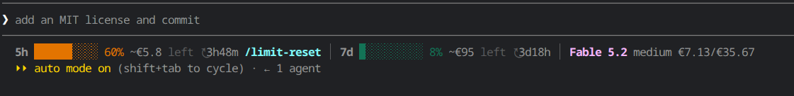

# claudecode-cli-statusline

A one-line status line for [Claude Code](https://code.claude.com/docs/en/statusline) that shows how much of your plan's usage limits is left, in percent and euro, and what the selected model costs.



```
5h ███░░░░░░░ 33% ~€16 left ↻4h34m /limit-reset │ 7d █░░░░░░░░░ 5% ~€186 left ↻3d19h │ Fable 5.2 xhigh €7.13/€35.67
```

| Part | Meaning |
| --- | --- |
| `5h` / `7d` | The 5-hour and the 7-day usage limit of a claude.ai subscription |
| `███░░░░░░░ 33%` | Share of the limit already used (green below 50%, yellow below 80%, then red) |
| `~€16 left` | Estimated euro value of the usage still left in that limit |
| `↻4h34m` | Time until the limit resets |
| `/limit-reset` | Shown while a manual reset is available |
| `Fable 5.2 xhigh` | Selected model and effort level; `~2.5×` after the effort is Claude Code's relative cost of that effort compared with the model's default, where it publishes one |
| `€7.13/€35.67` | List price per million input / output tokens (fast-mode price while fast mode is on) |

On a narrow terminal parts are dropped in this order: prices, long bars (they shrink to six cells), model, euro estimates, reset hint.

## Install

Requires Python 3.7+ (standard library only) on Linux or macOS. Tested with Claude Code 2.1.322.

Clone the repository and point `statusLine` in `~/.claude/settings.json` at the script:

```json
{
  "statusLine": {
    "type": "command",
    "command": "python3 /path/to/claudecode-cli-statusline/statusline.py",
    "refreshInterval": 60
  }
}
```

`refreshInterval` keeps the countdowns moving while a session is idle.

Claude Code picks up the change without a restart; the line appears after the first response of a session.

### On another computer

Repeat the two steps above. A few things start fresh there:

- The euro estimates are relearned, because the learned ratios live in `~/.claude/statusline/state.json`, outside this repository. Copy that file across to keep them.
- The usage bars need a claude.ai subscription login. With an API key there is no limit data and the bars stay empty.
- The exchange rate is fetched on the first run. Without network access the script uses a built-in fallback rate of 0.89.

## Where the numbers come from

- **Percentages and reset times** come from `rate_limits` in the status line input. Claude Code only provides them for claude.ai subscriptions, and only after the first response of a session. Until then the last seen values are shown; with no data at all the bar is followed by `–`.
- **Euro left is an estimate.** A subscription has no euro quota. The script watches Claude Code's list-price cost estimate (`cost.total_cost_usd`) and learns how many dollars of usage move each limit by one percentage point, then scales the remaining percentage by that. The figure appears after two percentage points of usage have been observed and gets steadier over time. Usage from claude.ai or other devices is not seen and is left out of the ratio.
- **Dollars are converted to euro** with the ECB reference rate, fetched in the background at most twice a day and cached. Set `CLAUDE_STATUSLINE_USD_EUR` (for example `0.89`) to use a fixed rate and never touch the network.
- **Manual reset** is read from `unusedLimitResetStatusCache` in `~/.claude.json`, the cache Claude Code keeps for its own `/limit-reset` notice. Claude Code refreshes it at startup. It is an internal detail and may change between versions.
- **Model prices and effort factors** are a table at the top of `statusline.py` (`MODELS`). Add a row when a new model ships; unknown models are shown without a price.

Behind a Claude apps gateway with a spend limit, the line shows that limit instead, with the real amount left.

## Configuration

| Environment variable | Effect |
| --- | --- |
| `CLAUDE_STATUSLINE_USD_EUR` | Fixed dollar-to-euro rate; disables the ECB fetch |
| `CLAUDE_STATUSLINE_DIR` | Where state is kept (default `~/.claude/statusline`) |
| `NO_COLOR` | Disable colours |

## Files

State is kept outside the repository, in `~/.claude/statusline/`:

- `state.json`: learned dollars-per-percentage-point ratios and the last seen limits
- `fx.json`: the cached exchange rate
- `error.log`: the last failure, if any
- `debug`: create this empty file to have every status line input written to `last-input.json`; delete it to stop

This project is not affiliated with Anthropic.
